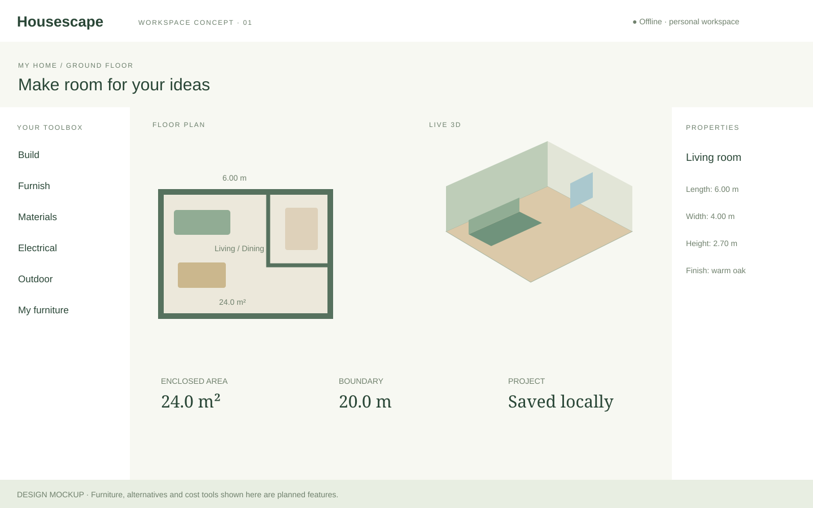

# Housescape

An offline Windows 11 space planner for personal use. **Geometry prototype 0.1.1**, not a complete floor-planning application.



## Run locally

Use Node.js 24 LTS or newer (Node 26 was used for local checks).

```sh
npm ci
npm run dev
```

Open the local address printed by Vite. Runtime assets are bundled locally; no account, AI service, remote fonts or CDN is used. Dependency installation requires network access or a prepopulated package cache. The browser preview needs its local server running; it is not an installable offline web app.

```sh
npm test
npm run build
```

## Windows desktop shell

Install Rust's MSVC toolchain, Microsoft C++ Build Tools (Desktop development with C++, including Windows SDK), and WebView2. Then:

```sh
npm run desktop
npm run desktop:build
```

The desktop build embeds `dist/` and produces `src-tauri/target/release/housescape.exe`. Installer bundling is deliberately disabled in this prototype. WebView2 is a prerequisite; a self-contained offline installer is future work. Windows CI compiles the shell and uploads the executable as a workflow artifact. Download the artifact only from a passing run.

## Try the prototype

- Choose Measured, Angled or Curved studio examples.
- Select a wall in the plan or wall list. Edit length, height, thickness and curve sweep.
- Drag a corner and release to commit a move snapped to a 0.1 m grid. Only the corner marker previews during dragging; both models update after release.
- Toggle a preset door opening; sample rooms also include a window. 3D wall geometry retains the sill/lintel and leaves the opening empty.
- Undo/redo using the buttons or Ctrl+Z / Ctrl+Y (Ctrl+Shift+Z also redoes).
- Orbit/zoom the 3D view and switch between split, 2D and 3D views.
- Save and reopen a local `.housescape` file. This initial format is plain versioned JSON, not the eventual asset archive. The desktop app uses native Open/Save As dialogs and reports success only after a completed write; cancelling a dialog leaves the project unchanged. The browser preview continues to use file selection/downloads.

## Mockups and design

- [Workspace concept](public/mockups/workspace.svg): build tools, measured plan, 3D and property inspector.
- [Layout comparison concept](public/mockups/layout-comparison.svg): future design alternatives and clearance/cost comparison.
- [In-app concept viewer](public/mockups/concept-viewer.svg): mockups open inside the application so they also work in the native shell. Close the viewer with its button or Escape.
- Regenerate SVG concepts with `node scripts/mockups.mjs`. Furniture, alternatives and cost tools in the concepts are **planned**, not implemented.

## Geometry contract and limits

Metres/radians; one ordered counterclockwise closed centreline boundary with shared node IDs. Analytic circular arcs supply lengths and centreline areas; bounded tessellation supplies rendering and self-intersection checks. Area is not net usable floor area. Constant wall thickness/height; arc sweep limited to ±171°. Basic miter joins are capped at extreme angles. Sharp bevels and overlapping thick wall footprints need further work; boundary validation is not a general solid-intersection solver.

Openings use arc-length offsets and remain at their offsets when wall lengths change. Edits that invalidate an opening are rejected. Changing sweep preserves the selected arc length. Length edits move the shared end node; they do not solve a global dimension constraint system. No room discovery, partitions, multiple rooms/floors, roofs, stairs, electrical tools, furniture, PDF/DXF export or scaled printing yet. No autosave/crash recovery or large-project performance claim.

See [architecture evaluation](docs/architecture-evaluation.md) and [validation record](docs/prototype-validation.md).
