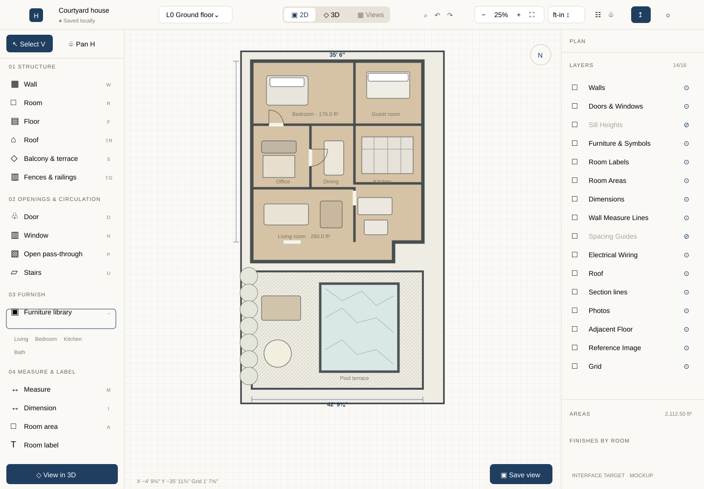

# Housescape

An offline Windows 11 space planner for personal use. **Editor prototype 0.2.0** follows the SpacePlanner-style desktop workflow. It is not yet a complete floor-planning application; see the [functional parity checklist](docs/spaceplanner-parity.md).



## Run locally

Use Node.js 24 LTS or newer (Node 26 was used for local checks).

```sh
npm ci
npm run dev
```

Open the local address printed by Vite. Runtime assets are bundled locally; no account, AI service, remote fonts or CDN is used. Dependency installation requires network access or a prepopulated package cache. The browser preview needs its local server running; it is not an installable offline web app.

```sh
npm test
npm run build
```

## Windows desktop shell

Install Rust's MSVC toolchain, Microsoft C++ Build Tools (Desktop development with C++, including Windows SDK), and WebView2. Then:

```sh
npm run desktop
npm run desktop:build
```

The desktop build embeds `dist/` and produces `src-tauri/target/release/housescape.exe`. Installer bundling is deliberately disabled in this prototype. WebView2 is a prerequisite; a self-contained offline installer is future work. Windows CI compiles the shell and uploads the executable as a workflow artifact. Download the artifact only from a passing run.

## Try the editor

- Open the H plans menu for local files and the Measured, Angled or Curved examples. Click the plan name to rename it.
- Start in full-canvas 2D; use the top 2D/3D switch or the bottom-left button to view the same geometry in 3D.
- V selects, H pans, R draws a rectangle and W draws a closed wall chain. This milestone redraws **one** room; undo restores the previous boundary. Exact rectangle sizes are available in the right inspector.
- Select a wall to edit its length, clear height, thickness and curve sweep. Display units default to feet/inches, with a metric selector. Unedited fields preserve their exact stored values despite rounded display fractions.
- Drag corners; snapping uses 3-inch or 0.1 m increments. Space-drag or middle-drag pans; scroll zooms around the cursor. Shift+F fits the room.
- Choose D Door, N Window or P Passage, then click a wall. Select an opening to edit its offset, width, sill and height, flip its 2D swing or remove it. 3D wall geometry retains the sill/lintel and leaves the opening empty.
- Use M to measure, I to add a persistent dimension and T to place a note. Available layer switches hide/show their corresponding 2D entities.
- Choose a solid floor tone, change north orientation, lock editing, search tools with Ctrl+K or capture a 3D PNG with Save view.
- Undo/redo using the buttons or Ctrl+Z / Ctrl+Y (Ctrl+Shift+Z also redoes).
- Orbit/zoom the 3D view and use Reset view to frame the current room.
- Save and reopen a local `.housescape` file. This initial format is plain versioned JSON, not the eventual asset archive. The desktop app uses native Open/Save As dialogs and reports success only after a completed write; cancelling a dialog leaves the project unchanged. The browser preview continues to use file selection/downloads.
- A local draft is saved after committed edits and validated on startup. This is not an atomic-file backup or full crash-recovery system.

## Mockups and design

- [2D editor target](public/mockups/editor-2d.svg) and [3D editor target](public/mockups/editor-3d.svg) replace the earlier geometry-lab design direction. Regenerate with `node scripts/reference-mockup.mjs`.
- Earlier concepts are retained as design history: [workspace](public/mockups/workspace.svg), [layout comparisons](public/mockups/layout-comparison.svg), [concept viewer](public/mockups/concept-viewer.svg). Regenerate those with `node scripts/mockups.mjs`.
- Design mockups open inside the application. Features drawn in mockups can be planned; the parity checklist is authoritative.

## Geometry contract and limits

Metres/radians; one ordered counterclockwise closed centreline boundary with shared node IDs. Analytic circular arcs supply lengths and centreline areas; bounded tessellation supplies rendering and self-intersection checks. Area is not net usable floor area. Constant wall thickness/height; arc sweep limited to ±171°. Basic miter joins are capped at extreme angles. Sharp bevels and overlapping thick wall footprints need further work; boundary validation is not a general solid-intersection solver.

Openings use arc-length offsets and remain at their offsets when wall lengths change. Edits that invalidate an opening are rejected. Changing sweep preserves the selected arc length. Length edits move the shared end node; they do not solve a global dimension constraint system. No room discovery, partitions, multiple rooms/floors, roofs, stairs, electrical tools, furniture, PDF/DXF export or scaled printing yet. No atomic-save/crash-recovery or large-project performance claim. The local draft uses WebView/browser storage and is separate from explicit project files.

See [architecture evaluation](docs/architecture-evaluation.md) and [validation record](docs/prototype-validation.md).
